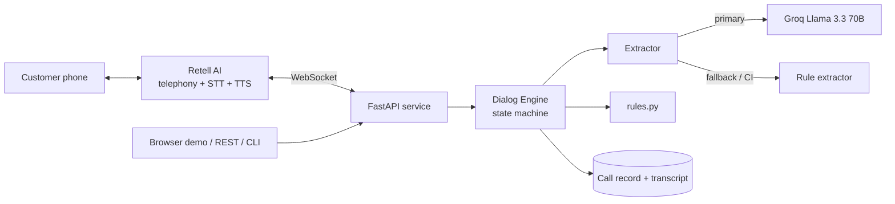

<div align="center">

# Home Credit - Loan Against Property Voice Agent

**An AI voice agent where the LLM listens and deterministic code decides.**

Calls existing customers about a pre-approved Loan Against Property (up to ₹75 lakh), runs an 8-field eligibility check, and hands qualified leads to a senior loan expert.

     

</div>

---

## Table of contents
1. [Why this project](#1-why-this-project)
2. [Demo](#2-demo)
3. [Key design decision](#3-key-design-decision-the-llm-extracts-code-decides)
4. [High-level architecture](#4-high-level-architecture)
5. [How a call works](#5-how-a-call-works)
6. [Business rules](#6-business-rules)
7. [Conversation state model](#7-conversation-state-model)
8. [Tech stack](#8-tech-stack)
9. [Repository layout](#9-repository-layout)
10. [Quick start](#10-quick-start)
11. [Configuration](#11-configuration)
12. [Voice calls with Retell AI](#12-voice-calls-with-retell-ai)
13. [API reference](#13-api-reference)
14. [Testing and quality](#14-testing-and-quality)
15. [Design trade-offs and known limitations](#15-design-trade-offs-and-known-limitations)
16. [How to make the system better](#16-how-to-make-the-system-better)
17. [Deployment](#17-deployment)
18. [Contributing and workflow](#18-contributing-and-workflow)
19. [License](#19-license)

---

## 1. Why this project

Outbound loan-qualification calls are repetitive, rule-heavy and easy to get wrong. A natural-sounding agent that applies the wrong eligibility rule, forgets a field, or promises approval creates compliance and conversion problems.

This project shows how to build a **production-minded voice agent** instead of a prompt-only demo:

- It tracks 8 eligibility fields and **never re-asks a known one**, even when a customer packs several answers into one sentence.
- Eligibility, rule priority and the handoff gate are **plain tested Python**, not model behaviour.
- It degrades gracefully: if the LLM is unavailable, a rule-based extractor keeps the call alive.
- Every call produces a **structured JSON record** ready for a CRM or loan-origination system.

**Use case (from the assignment):** call an existing customer, verify identity, present the offer, run the checklist, handle disqualification / loan-transfer / busy / wrong-person / do-not-call paths, then hand off to a senior loan expert who provides exact interest rates.

## 2. Demo

| Surface | How |
|---|---|
| Browser voice demo (free, no telephony) | `uvicorn app.main:app` then open `http://localhost:8000` in Chrome |
| Terminal simulator | `python -m app.cli` (try `--lang hi --gender male`) |
| Real phone/web call | Retell AI custom-LLM WebSocket, see [section 12](#12-voice-calls-with-retell-ai) |

**Real engine output** (scenario T10, rule-based extractor): one sentence fills four fields.

```text
Agent    : What type of property is it: residential, commercial, or industrial?
Customer : I'm self-employed, I have my own commercial shop, and I need forty lakh for eight years
Agent    : Got it. Do you have the original property documents available for verification?
```

Captured: `property_type=commercial`, `occupation=self_employed`, `loan_amount_lakh=40`, `tenure_years=8`, `ownership=sole` (inferred from "my own"). Occupation, loan amount and tenure were never asked.

More transcripts for every scenario: [`docs/test_results.md`](docs/test_results.md).

**Live call recordings** (add your own real links here):

| Scenario | Retell call link |
|---|---|
| Happy path with out-of-order answers | _add link_ |
| Existing loan to transfer | _add link_ |
| Disqualification | _add link_ |
| Hindi, female agent | _add link_ |

## 3. Key design decision: the LLM extracts, code decides

| Concern | Prompt-only agent | This design |
|---|---|---|
| Eligibility rules | Model may drift or hallucinate | [`app/rules.py`](app/rules.py), unit-tested, auditable |
| Never re-ask a known field | Probabilistic | `CallState.next_missing()` guarantees it |
| Handoff gate | Hopes the model obeys | `HANDOFF` is only reachable when all 8 fields are known |
| Rule priority | Ordered in prose | Ordered `if` chain in `DialogEngine._step` |
| Regression testing | Manual calls | 26 scripted scenarios in CI |
| LLM outage or quota | Call fails | Falls back to the rule-based extractor |

The model is asked one narrow question per turn: *"what facts did the customer just state?"* Its JSON output is validated with Pydantic before it touches state. All decisions, such as disqualify, transfer or ask the next question, are made by code.

> A single-prompt version is also included for platforms like Retell/Bolna single-prompt agents: [`prompts/system_prompt_final.md`](prompts/system_prompt_final.md).

## 4. High-level architecture




| Component | Responsibility |
|---|---|
| **Retell AI** | Telephony, speech-to-text, text-to-speech, interruption handling |
| **FastAPI service** | REST API, browser demo, Retell custom-LLM WebSocket (`/llm-websocket/{call_id}`) |
| **Dialog engine** (`app/dialog.py`) | Per-turn decision pipeline and call state |
| **Extractor** (`app/extractor.py`) | Turns speech text into structured facts (Groq primary, regex fallback) |
| **Rules** (`app/rules.py`) | Hard eligibility rules |
| **Responses** (`app/responses.py`) | English and Hindi wording with gender-aware grammar |
| **Storage** (`app/storage.py`) | Saves the JSON call record and transcript |

## 5. How a call works

### Per-turn pipeline


Rule priority, highest first:

1. Privacy (wrong person), do-not-call, not interested
2. Busy customer, collect callback time
3. Customer asks for a human
4. Existing loan or EMI reduction, route to transfer specialist (**beats ordinary disqualification**)
5. Hard disqualification (agricultural, cash income, no original documents)
6. Corrections: loan above ₹75 lakh, tenure outside 3-15 years
7. Normal eligibility questions (first unknown field only)
8. Handoff, only when all 8 fields are known

### Call lifecycle and exit paths


Nine terminal outcomes: `handoff`, `disqualified`, `transfer`, `callback`, `human_callback`, `wrong_person`, `do_not_call`, `declined`, `unclear_callback`.

## 6. Business rules

| Field | Eligible | Otherwise |
|---|---|---|
| Property type | Residential, commercial, industrial | Agricultural: disqualify |
| Ownership | Sole or joint | Both accepted |
| Original documents | Available for verification | Photocopies, lost, none: disqualify |
| Loan amount | ₹75 lakh or less | Above: explain the cap, offer ₹75 lakh; if refused, end politely |
| Occupation | Salaried or self-employed | Both accepted |
| Income mode | Bank | Cash: disqualify |
| Market value | Any estimate | No minimum is specified, none is invented |
| Tenure | 3 to 15 years | Explain the range and ask again; if refused, disqualify |

The assignment lists seven questions, but "occupation and income mode" are two data fields, so the agent tracks **eight**.

Other guarantees: never quotes interest rates or fees, never promises approval, never asks for OTPs or card numbers, and reveals nothing about the loan to a wrong-person answerer.

## 7. Conversation state model

```python
class CallState(BaseModel):
    stage: Stage                       # VERIFY, AVAILABILITY, CALLBACK_TIME, QUALIFY, CONFIRM_MAX, FIX_TENURE, ENDED
    property_type, ownership, documents_available, loan_amount_lakh,
    occupation, income_mode, market_value_lakh, tenure_years   # the 8 fields, None = unknown
    pending_amount_lakh, pending_tenure_years                  # invalid values awaiting a correction round
    outcome: Outcome; reason: str | None
```

Per turn: **extract, apply priority rules, capture facts (latest answer wins), check disqualifiers, ask the first unknown field, check the handoff gate.**

Example structured post-call record:

```json
{
  "call_outcome": "handoff",
  "identity_verified": true,
  "property_type": "residential",
  "ownership": "joint",
  "original_documents": true,
  "loan_amount_lakh": 75.0,
  "occupation": "salaried",
  "income_mode": "bank",
  "market_value_lakh": 80.0,
  "tenure_years": 12.0,
  "existing_loan_mentioned": false,
  "all_fields_complete": true
}
```

## 8. Tech stack

| Layer | Choice | Why |
|---|---|---|
| Language / API | Python 3.10+, FastAPI, WebSocket | Async, typed, easy Retell integration |
| Validation | Pydantic v2 | Typed state; validates LLM output before use |
| LLM | Groq, Llama 3.3 70B (free tier), JSON mode | Fast, free, strong at Hinglish extraction |
| Fallback | Regex / clause-level rule extractor | Offline, deterministic, powers CI |
| Voice | Retell AI | Telephony, STT, TTS, barge-in |
| Quality | pytest, ruff, GitHub Actions | Tests and lint on every push and PR |
| Packaging | Docker | One image, deploy anywhere |

## 9. Repository layout

```text
.
├── app/
│   ├── dialog.py        # decision pipeline (the brain)
│   ├── rules.py         # eligibility rules
│   ├── extractor.py     # Groq + rule-based fact extraction
│   ├── responses.py     # English / Hindi wording, gender-aware
│   ├── models.py        # CallState, enums, constants
│   ├── main.py          # FastAPI app, REST, Retell WebSocket
│   ├── storage.py       # JSON call records
│   ├── cli.py           # terminal simulator
│   └── static/demo.html # browser voice demo
├── prompts/system_prompt_final.md   # single-prompt version for Retell/Bolna
├── tests/               # 26 scenarios + parsing + API/WebSocket tests
├── scripts/
│   ├── run_scenarios.py # regenerates docs/test_results.md
│   └── make_diagrams.py # regenerates docs/images/*.png (pip install matplotlib pillow)
├── docs/                # architecture.md, test_results.md, images/
├── evidence/            # your real call links and recordings
├── .github/workflows/ci.yml
├── Dockerfile · Makefile · pyproject.toml · requirements*.txt · .env.example
```

## 10. Quick start

```bash
git clone https://github.com/SidharthA7204/home-credit-lap-voice-agent.git
cd home-credit-lap-voice-agent
python -m venv .venv && source .venv/bin/activate     # Windows: .venv\Scripts\activate
pip install -r requirements-dev.txt
cp .env.example .env                                   # works with no API key
pytest -q                                              # 40 tests
python -m app.cli                                      # chat in the terminal
uvicorn app.main:app --reload                          # http://localhost:8000 voice demo (Chrome)
```

Optional: add a free Groq key from <https://console.groq.com/keys> to `.env` as `GROQ_API_KEY=...`. `GET /health` then reports `"llm": "groq"`. Any Groq error automatically falls back to the rule extractor.

## 11. Configuration

| Variable | Default | Purpose |
|---|---|---|
| `GROQ_API_KEY` | empty | Enables LLM extraction; empty means rule-based only |
| `GROQ_MODEL` | `llama-3.3-70b-versatile` | Groq model name |
| `COMPANY_NAME` | `Home Credit` | Spoken company name |
| `AGENT_NAME` | `Riya` | Agent persona name |
| `AGENT_GENDER` | `female` | Drives gendered Hindi grammar |
| `DEFAULT_LANGUAGE` | `en` | `en` or `hi` |
| `MAX_UNCLEAR_RETRIES` | `3` | Failed attempts before arranging a callback |
| `DATA_DIR` | `data/calls` | Where call records are saved |

## 12. Voice calls with Retell AI

**Option A: single prompt (matches the assignment text).** Create a Retell *Single Prompt* agent, paste [`prompts/system_prompt_final.md`](prompts/system_prompt_final.md), choose a voice matching `agent_gender`, enable the End Call function, and define the dynamic variables `company_name, customer_name, agent_name, agent_gender, current_date, current_day, current_time, additional_context_from_rag, language_to_speak`.

**Option B: custom LLM (this repo's engine drives the call).**
1. Run `uvicorn app.main:app --port 8000` and expose it (`ngrok http 8000`, or deploy the Docker image).
2. In Retell create a *Custom LLM* agent with WebSocket URL `wss://<your-host>/llm-websocket` (Retell appends `/{call_id}`).
3. Pass dynamic variables when creating the call; the server reads them from Retell's `call_details` event.
4. Protocol handling lives in `app/main.py::retell_ws`. Check Retell's current Custom-LLM docs if field names change.

Handled events: `call_details`, `response_required`, `reminder_required`, `ping_pong`; stale responses are dropped when the customer interrupts.

## 13. API reference

| Method | Path | Purpose |
|---|---|---|
| GET | `/health` | Status and active extractor |
| POST | `/api/sessions` | Start a call `{customer_name, language, agent_gender}`, returns the opening line |
| POST | `/api/sessions/{id}/turn` | `{utterance}` returns reply, outcome and structured state |
| GET | `/api/sessions/{id}` | State and transcript |
| WS | `/llm-websocket/{call_id}` | Retell custom-LLM protocol |

```bash
curl -s -X POST localhost:8000/api/sessions -H 'content-type: application/json' -d '{"customer_name":"Rahul Sharma"}'
```

## 14. Testing and quality

- **40 automated tests**: 26 scripted conversation scenarios, number/tenure parsing, REST flow, Retell WebSocket protocol.
- **CI** runs `ruff` and `pytest` on Python 3.10 and 3.12 for every push and PR.
- `make report` regenerates [`docs/test_results.md`](docs/test_results.md) from real runs, with full transcripts.

| Category | Scenarios |
|---|---|
| Happy path | 1 |
| Disqualification (agricultural, cash, no originals, amount refused, tenure refused, contradiction) | 6 |
| Transfer (existing loan, EMI reduction, priority conflict) | 3 |
| Corrections and memory (amount cap, tenure fix, out-of-order, changed answer, vague value) | 6 |
| Diversions (interest rate, "what is a LAP?") | 2 |
| Call control (busy x2, wrong person, do-not-call, unclear audio, human request) | 6 |
| Hindi and gender grammar (female, male) | 2 |

> **Honesty note:** these are simulated text conversations against the engine. They prove the logic, not live voice quality or latency. Real call evidence belongs in `evidence/`.

## 15. Design trade-offs and known limitations

- **Rule extractor is conservative.** Groq handles messy Hinglish and unusual phrasing; the regex fallback is a safety net, not parity.
- **Sessions are in memory.** Multi-instance deployment needs Redis.
- **Ownership can be inferred from "my own".** Reasonable, but a confidence check should confirm it.
- **Templated replies** are safe and predictable but can sound repetitive over long calls.
- **No live-call benchmarks yet** for latency, barge-in or voice quality.
- **Compliance is out of scope:** DNC registry, recording consent and PII redaction belong at the dialer layer.
- **Mixed income** ("part cash, part bank") is treated as unclear and re-asked, not decided.

## 16. How to make the system better

**Reliability and accuracy**
- Add per-field **confidence scores** from the extractor; confirm low-confidence facts ("Just to confirm, that's 40 lakh?").
- **Ensemble extraction:** run both extractors and flag disagreements instead of trusting one.
- Fuller **Hindi/Hinglish number parsing** ("dedh crore", "paanch lakh") and code-switching tests.
- Handle **STT noise**: phonetic variants for amounts and locality words, n-best hypotheses from the STT layer.

**Voice experience**
- Replace templated replies with **LLM-phrased responses constrained by the decided action**, so wording varies but decisions stay deterministic.
- Tune **barge-in, endpointing and response delay**; measure time-to-first-word per turn.
- Pick and A/B test **voices**; add SSML for natural currency and number pronunciation.

**Scale and operations**
- Move sessions to **Redis**; run stateless replicas behind a load balancer.
- **Webhook on call end** to push the JSON record into a CRM / LOS; add retry and a dead-letter queue.
- **Observability:** structured logs, per-turn latency metrics, outcome funnel dashboard (verified, qualified, disqualified, transfer, callback).
- **Dialer integration:** campaign scheduling, retry windows, answering-machine detection.

**Evaluation**
- Record real calls for every scenario and store them in `evidence/`.
- Build an **LLM-as-judge eval harness** over real transcripts (rule adherence, repetition, tone).
- Add **adversarial and fuzz tests** (contradictions, fillers, long monologues, silence, background speech).
- Track regression metrics per prompt/model change.

**Compliance and security**
- DNC registry check, call-recording consent line, PII redaction in logs, data-retention policy.
- Rate limiting and auth on the REST API; secrets via a vault, not `.env`.

**Product**
- More languages (Tamil, Telugu, Marathi, Bengali), **warm transfer** to a live loan expert, calendar-based callback booking, and conversion A/B tests on scripts.

## 17. Deployment

```bash
docker build -t lap-voice-agent .
docker run -p 8000:8000 --env-file .env lap-voice-agent
```

Deploy the same image to Render, Railway or Fly.io; set the variables from [section 11](#11-configuration); use the public `wss://` URL in Retell.

## 18. Contributing and workflow

```bash
git checkout -b feat/short-description
make lint && make test
git commit -m "feat: short description"      # Conventional Commits: feat, fix, test, docs, refactor
git push -u origin feat/short-description    # open a PR; CI must be green
```

Adding a scenario: append a `Scenario(...)` to `tests/scenarios.py`, run `make report`, commit the regenerated `docs/test_results.md`.

## 19. License

MIT. See [`LICENSE`](LICENSE).
