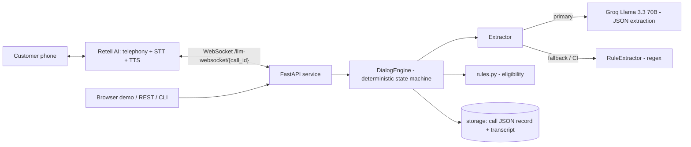

# Architecture

## Why hybrid (LLM extracts, code decides)
| Concern | Prompt-only agent | This design |
|---|---|---|
| Eligibility rules | LLM may drift or hallucinate | `rules.py`, unit-tested, auditable |
| "Never re-ask answered questions" | Probabilistic | `CallState.next_missing()` - guaranteed |
| Handoff gate | Hopes the LLM obeys | Code only reaches `HANDOFF` when all 8 fields known |
| Rule priority | Natural-language ordering | Ordered `if` chain in `DialogEngine._step` |
| Regression testing | Manual calls | 26 scripted scenarios in CI |
| LLM outage / quota | Call fails | Falls back to rule extractor |

## Per-turn algorithm
`extract -> privacy/DNC -> identity gate -> busy/callback -> human -> existing-loan transfer -> stage handling (amount cap / tenure fix) -> capture facts (latest wins) -> hard disqualifiers -> first missing field -> handoff gate`

## Two ways to submit / demo
1. **Assignment-style (single prompt):** paste `prompts/system_prompt_final.md` into a Retell/Bolna "single prompt" agent.
2. **Engineering-style (this repo):** Retell "Custom LLM" pointing at the FastAPI WebSocket; or use the free browser demo / CLI.

## Production notes / known limits
- Sessions are in-memory: use Redis for multi-instance deployments.
- RuleExtractor is intentionally conservative; Groq handles messy Hinglish and unusual phrasing.
- Compliance (DNC registry, call-recording consent) must be enforced by the dialer layer.
